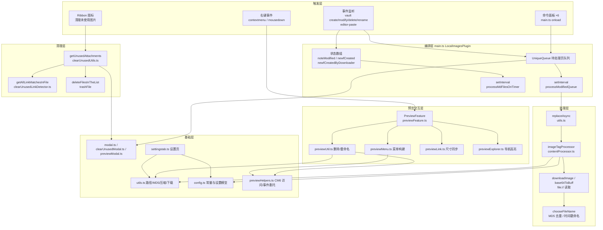

# 01 — 项目架构总览

## 1. 总体定位

ImgBox Pro 是标准形态的 Obsidian 插件：入口为 `src/main.ts` 导出的 `LocalImagesPlugin`（继承 `Plugin`），经 Rollup 打包为 CommonJS 单文件 `main.js`，运行在 Obsidian 的 Electron 渲染进程中，通过 Obsidian API（`app.vault` / `app.metadataCache` / `app.fileManager` / `app.workspace`）操作笔记与附件。

插件围绕两条主线组织代码：

- **本地化流水线**（把外部媒体变成库内文件并改写链接）
- **附件清理流水线**（找出未被引用的文件并删除）

外加一条独立的 **预览交互线**（右键菜单、定位、跳转等编辑器增强）。

## 2. 分层架构



## 3. 插件生命周期

| 阶段 | 位置 | 行为 |
| --- | --- | --- |
| `onload` | `src/main.ts` L219 | ① `loadSettings()` 合并默认配置；② 注册 6 个命令；③ `refreshRibbonIcons()` 挂 Ribbon；④ 注册 4 个 vault 事件 + `editor-paste`；⑤ 启动队列定时器；⑥ 实例化 `PreviewFeature` 并加载；⑦ 注册 `SettingTab` |
| 运行中 | — | 定时器驱动的两条队列（见 §5）；DOM MutationObserver 维护视频宽度与导航高亮 |
| `onunload` | `src/main.ts` L1174 | `previewFeature.onunload()`：断开 observer、清理高亮类与抑制计时器、移除 `af-suppress-file-explorer-flash` |

## 4. 核心数据流

### 4.1 手动本地化（命令触发）

```
命令面板 → processActivePage(defaultdir)
        → processPage(file)
        → vault.cachedRead(file)
        → replaceAsync(content, MD_SEARCH_PATTERN, imageTagProcessor(...))
             ├─ 对每个匹配的外链：downloadImage / base64ToBuff / file:// 读取
             ├─ getFileExt 魔数判型 → PNG 压缩（可选）
             ├─ chooseFileName：MD5 去重 → 时间戳命名
             └─ vault.createBinary 写入 → getRDir 生成新链接
        → [新内容, 错误标志, 新文件列表]
        → vault.modify(file) 回写笔记
```

- 全部成功 → 状态通知；部分失败（返回 `null`）→ 警告通知（`errorflag=true`）。
- 新生成的文件路径会推入 `newfCreatedByDownloader`，防止随后被"新附件搬迁"流程重复搬移。

### 4.2 自动本地化（粘贴/新建触发）

```
editor-paste（含媒体链接或文件）
  → onPasteFunc：把当前笔记入队 modifiedQueue → setupQueueInterval
vault "create"（新建 .md）
  → onMdCreateFunc：10s 内的新文件 → 入队 + 启动搬迁定时器
vault "create"（新建附件）
  → onFCreateFunc：记录 newfCreated，推断目标笔记（活动笔记 > 粘贴笔记 > 最近新建笔记）
  → 定时器 processMdFilesOnTimer：
      对每个 noteModified 笔记：
        读取 Obsidian 默认附件目录 obsmdir 中的新文件
        → 移动/重命名到插件目录 mdir（时间+MD5 或原名清洗）
        → PNG 压缩 / MD5 去重 / "(n) " 防冲突
        → 改写笔记内链接（appendOriginalName 追加 "Open:" 标签）
```

### 4.3 清理流水线

```
命令/Ribbon → clearUnusedAttachments("image" | "all")
  → getUnusedAttachments：
      库内候选（图片 或 全部非 md/canvas 文件）
      − 已使用集合（resolvedLinks + frontmatter + 链接检测 + canvas 节点）
  → ClearUnusedPreviewModal 预览确认（最多列出 80 条）
  → deleteFilesInTheList：逐个 trashFile（跳过排除文件夹）
  → ClearUnusedLogsModal 日志 / Notice 汇总
```

孤立附件清理（`removeOrphans("plugin")`）是另一条变体：仅限"笔记旁模式 + `${notename}` 结尾"设置，对比当前笔记引用名集合与附件文件夹内容，弹 `ModalW1` 确认后逐个 `trashFile`。

### 4.4 预览交互流

```
contextmenu（img/iframe/video/audio/div.file-embed-title，capture 阶段）
  → PreviewFeature.onRightClickMenu
      ├─ 预览模式 → addMenuExtendedPreviewMode（复制图片/系统打开/导航定位）
      └─ 源码模式 → posAtDOM 取位置 → addMenuExtendedSourceMode
              （+ 重命名 handlerRenameFile / 删除文件及链接 handlerDelFileNew）
外部图片 mousedown（右键）
  → externalImageContextMenuCall → addExternalImageMenu*(预览/源码两套)
删除动作 → checkReferenceInfo（resolvedLinks 引用计数）
      state 0：删链接 + trashFile（文件夹只剩它时连文件夹一起删）
      state 1/2：仅删当前链接，保留文件
```

## 5. 队列与定时器机制

`LocalImagesPlugin` 用**两条定时器 + 若干状态数组**实现自动处理（全部时间间隔来自设置 `autoProcessInterval`，秒）：

| 成员 | 类型 | 作用 |
| --- | --- | --- |
| `modifiedQueue` | `UniqueQueue<TFile>` | 待本地化笔记队列；`push(value, attempts)` 去重并记录剩余轮次，`iterationQueue()` 取出本轮并递减 |
| `intervalId` | `number` | 队列定时器句柄（`setupQueueInterval` L520 创建/重建） |
| `noteModified` | `TFile[]` | 等待"新附件搬迁"的笔记 |
| `newfCreated` | `string[]` | 新建附件路径（搬迁候选） |
| `newfCreatedByDownloader` | `string[]` | 下载器刚写入的文件，搬迁时跳过 |
| `newfProcInt` | `number` | 搬迁定时器句柄（`setupNewMdFilesProcInterval` L1147） |
| `newfMoveReq` | `boolean` | 是否存在待搬迁请求 |
| `latestCreatedMarkdownFile` / `pendingPastedMarkdownFile` / `pendingPastedMarkdownTime` | — | 粘贴文件时推断归属笔记（10 秒窗口，`RECENT_CREATED_FILE_MAX_AGE_MS = 10000`） |

新文件有效性判断统一用 10 秒年龄窗口：`Math.abs(Date.now() - file.stat.ctime/mtime) > 10000` 则忽略，避免同步/索引恢复时误触发。

## 6. 关键设计决策

1. **正则驱动的内容替换**：`MD_SEARCH_PATTERN`（`src/config.ts` L16）是 4 个正则的数组，分别匹配 `file://` 链接、`http(s)` 链接、Base64 data URI 与兜底模式；`replaceAsync` 先收集全部匹配再并发处理，最后统一 `replaceAll` 回写。
2. **MD5 采样签名**（`utils.ts` L47）：不哈希全文件，而是取头/中/尾各 15KB 拼接后 md5（后缀 `_MD5`），在去重准确率与性能间折中。
3. **魔数判型优先**（`utils.ts` L232–L345）：文件扩展名以二进制内容为准（PNG/JPG/GIF/BMP/PDF/ZIP/MP3/MKV/OGG/FLV + ISOBMFF brand → avif/heic/mp4/mov + RIFF→webp + SVG 文本嗅探），URL 扩展名只作回退。
4. **删除一律走 `app.fileManager.trashFile()`**：遵循 Obsidian 全局删除偏好（26.0.4 起移除了自有的"删除去向"设置）。
5. **CM6 私有访问收口**：Obsidian 未公开 `editor.cm`，`previewHelpers.getEditorView()`（L47）将其收窄为显式的 `CodeMirrorEditorView` 结构类型，全库统一经此访问。
6. **双语机制**：无 i18n 框架，运行时读 `document.documentElement.lang` 判断中英文（`isChineseDisplayLanguage()`），设置页文案集中在 `settingstab.ts` 的 `LOCALE_TEXT` 字典。
7. **类型补丁**：`src/obsidian-compat.d.ts` 为 Obsidian 未公开 API（`Vault.getConfig`、`App.internalPlugins`、`DataAdapter.readBinary` 等）做模块扩充声明；`src/filenamify-module.d.ts` 为 `filenamify/browser` 子路径提供类型垫片。

## 7. 目录结构

```
obsidian-imgbox-pro/
├── src/                    # 全部 TypeScript 源码（23 个文件）
│   ├── main.ts             # 插件入口与编排
│   ├── config.ts           # 常量 + ISettings + DEFAULT_SETTINGS
│   ├── contentProcessor.ts # 链接替换核心
│   ├── utils.ts            # 通用工具箱
│   ├── uniqueQueue.ts      # 去重队列
│   ├── modal.ts            # 通用确认/提示弹窗
│   ├── settingstab.ts      # 设置页
│   ├── clearUnused*.ts     # 附件清理（检测/工具/弹窗）
│   ├── preview*.ts         # 预览交互（功能/菜单/工具/链接/导航/事件/视频）
│   ├── previewModal.ts     # 删除笔记及附件确认弹窗
│   └── *.d.ts              # 环境类型补丁
├── main.js                 # 构建产物（Obsidian 加载的入口，根目录）
├── styles.css              # 插件样式（设置页 lip-* / 预览交互 af-* / 清理弹窗 unused-images-*）
├── manifest.json           # 插件清单（id/版本/minAppVersion）
├── versions.json           # 版本 → 最低 Obsidian 版本映射
├── rollup.config.js        # 构建配置
├── eslint.config.mjs       # ESLint（含 eslint-plugin-obsidianmd）
├── dist/                   # 构建输出（发布产物）
└── .github/workflows/release.yml   # tag 触发的发布 CI
```
