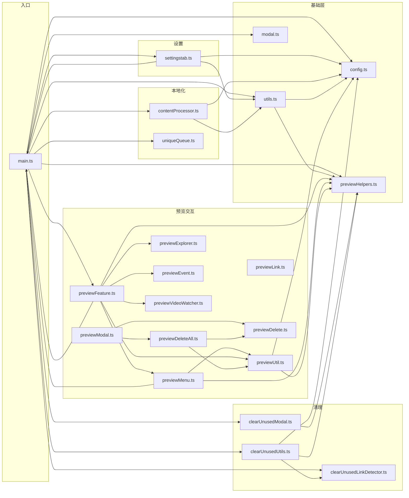

# 04 — 依赖关系

## 1. 运行时依赖（dependencies）

| 包 | 版本 | 用途 | 使用位置 |
| --- | --- | --- | --- |
| `async-lock` | 1.4.1 | `AsyncLock`：按匹配原文加锁，串行化同一图片的并发处理，防止重复合并/写入 | [contentProcessor.ts](../src/contentProcessor.ts#L23) |
| `blueimp-md5` | 2.19.0 | 纯 JS MD5：附件内容指纹（去重、时间戳命名后缀） | [utils.ts](../src/utils.ts#L2) `md5Sig` |
| `filenamify` | github:Sergei-Korneev/filenamify（5.0.1 fork） | 文件名合法化（`filenamify/browser` 子路径，避免 Node 专用 API） | [utils.ts](../src/utils.ts#L1) `cleanFileName` |

三个依赖都很轻量、无传递依赖，经 Rollup `nodeResolve + commonjs` 全部打进 `main.js`（仅 `obsidian` 被标记 external）。

## 2. 宿主环境（peer）

| 项 | 说明 |
| --- | --- |
| `obsidian` API（devDependencies `^1.0.3`） | 唯一 external 模块，运行时由 Obsidian 注入。插件使用 `Plugin/Modal/Setting/SettingGroup/Menu/Notice/TFile/TFolder/TAbstractFile`、`requestUrl`、`htmlToMarkdown`、`Platform`、`FileSystemAdapter`、`fileManager.trashFile/renameFile`、`metadataCache.resolvedLinks/getFileCache/getFirstLinkpathDest`、`vault.getConfig/createBinary/adapter`、`workspace.on(...)` 等 |
| Obsidian `minAppVersion` **1.11.0** | 因设置页使用 1.11 新增的 `SettingGroup` API（[settingstab.ts](../src/settingstab.ts#L281)） |
| Electron/浏览器内置 API | `MutationObserver`、`canvas`（压缩/剪贴板）、`FileReader`、`ClipboardItem`、`atob/TextDecoder`、`URL/CSS.escape` |
| 桌面端专有 | `openWithDefaultApp`、`showInFolder`、`internalPlugins.getEnabledPluginById("file-explorer")`（均为未公开 API，见 `obsidian-compat.d.ts`）；移动端降级提示 |
| CodeMirror 6 | Obsidian 内置；插件**不打包** CM，仅通过 `editor.cm` 以结构类型 `CodeMirrorEditorView` 访问（devDependencies 的 `@codemirror/state/view` 仅供类型参考） |

## 3. 开发依赖（devDependencies）

| 包 | 用途 |
| --- | --- |
| `rollup` ^2.32.1 + `rollup-plugin-esbuild` | 打包与 TS/JSX 转译（target es2021） |
| `@rollup/plugin-node-resolve` / `commonjs` / `json` | 依赖解析、CJS 互操作、JSON 导入 |
| `esbuild` ^0.28.2 | esbuild 插件底层 |
| `typescript` ^5.9.3 + `tslib` | 类型检查（`noImplicitAny`，不 emit，产物由 esbuild 生成） |
| `eslint` ^10.9.1 + `eslint-plugin-obsidianmd` ^0.4.2 | 代码检查，含 Obsidian 官方插件规则（如 `editor-drop-paste`） |
| `json` ^11.0.0 | `npm version` 脚本中同步 `manifest.json` / `versions.json` |
| `@types/async-lock`、`@types/blueimp-md5` | 第三方类型 |
| `@codemirror/state`、`@codemirror/view` | CM6 类型参考（不参与打包） |

## 4. 内部模块依赖图

箭头方向 = "依赖于"。`main.ts` 是依赖图的汇聚点；`previewHelpers.ts` 位于最底层（无内部依赖，被最广引用）。

要点：

1. **`main.ts` ↔ `previewFeature/settingstab` 双向引用**：后者需要插件实例类型与 `settings/previewFeature` 成员（仅类型 + 运行时注入，无循环加载问题，Rollup 正常处理）。
2. **`utils.ts → previewHelpers.ts`**：`utils` 的 `displayError` 复用 `isChineseDisplayLanguage()`，使基础层依赖了交互层的一个叶子函数；这是当前分层中唯一的"反向"边，但 `previewHelpers` 本身零内部依赖，无环。
3. **`clearUnusedUtils` 同时被 `main.ts` 与（历史上）`previewDeleteAll` 语义关联**：清理与"删除笔记及附件"共享"是否被其他笔记引用"的判定思路（前者用链接检测 + resolvedLinks，后者仅用 resolvedLinks）。

## 5. 对 Obsidian 未公开 API 的依赖清单

集中声明在 [obsidian-compat.d.ts](../src/obsidian-compat.d.ts)，升级 Obsidian 时需重点回归：

| API | 使用场景 |
| --- | --- |
| `Plugin.ensureFolderExists` | 本插件自行实现并挂到类上，声明扩充以便 `contentProcessor` 调用 |
| `Vault.getConfig("attachmentFolderPath" / "useMarkdownLinks")` | 读取用户 Obsidian 附件与链接偏好 |
| `Vault.exists` | 孤立附件目录判断 |
| `DataAdapter.exists(path, sensitive?)` / `readBinary` | 文件存在性探测与二进制读取（去重、搬迁） |
| `Workspace.activeEditor` | 类型引用 |
| `TAbstractFile.children` | 文件夹子项遍历（MD5 查重、孤立附件） |
| `App.internalPlugins.getEnabledPluginById("file-explorer").revealInFolder` | 导航定位 |
| `App.openWithDefaultApp / showInFolder` | 系统打开（previewMenu，桌面端） |
| `Editor.cm` | CodeMirror 6 视图访问（previewHelpers） |
| `app.vault.getConfig` 的返回值假定 | `useMarkdownLinks` 决定 wiki/md 两种输出格式 |

## 6. 外部服务依赖

| 服务 | 场景 | 位置 |
| --- | --- | --- |
| 图片源站点 | `downloadImage`（`requestUrl` + Chrome UA） | utils.ts L215 |
| `api.allorigins.win` | 剪贴板取图失败时的 CORS 代理重试（最多 3 次） | previewHelpers.ts L98 `loadImageBlob` |
| `file://` 本地读取 | 桌面端经 `requestUrl` 读取；移动端明确不支持 | contentProcessor.ts L57 |
